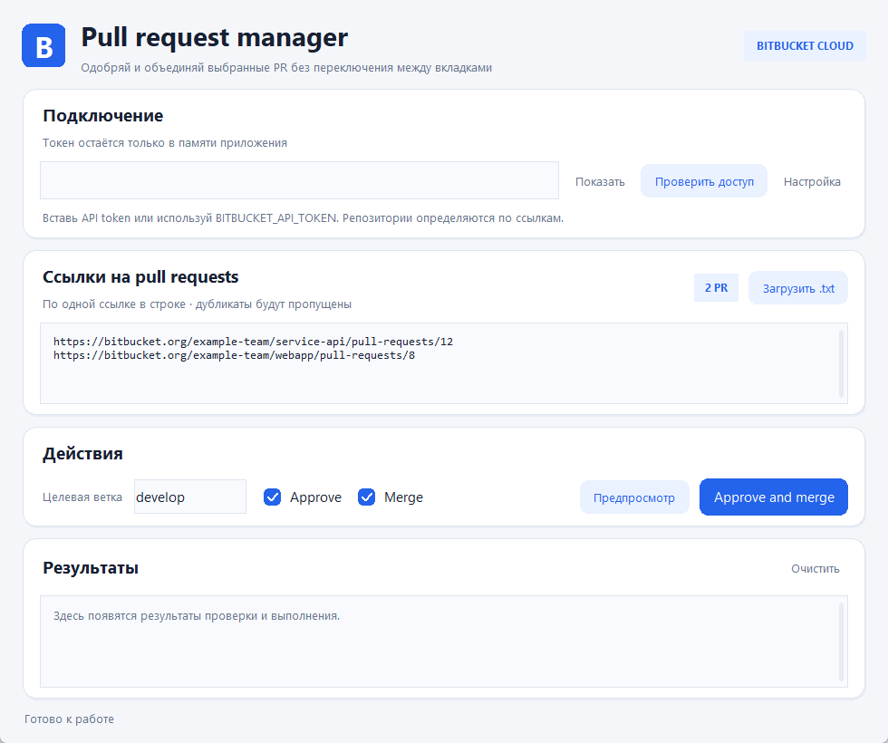

# Bitbucket PR Manager

Небольшое приложение для Bitbucket Cloud: вставь ссылки на PR, проверь план и отдельно выбери **Approve** и **Merge**. Merge выключен по умолчанию. Приложение последовательно обрабатывает только указанные ссылки и показывает ответ Bitbucket для каждого PR. У кнопки выполнения короткие подписи: **Approve**, **Merge** или **Approve and merge**.



## Быстрый запуск

Готовые сборки для Windows, Linux, macOS Apple Silicon (`arm64`) и macOS Intel находятся в [Releases](https://github.com/Ikalike112/bitbucket-pr-manager/releases). Скачай архив для своей ОС и запусти приложение. Сборки создаёт [GitHub Actions](.github/workflows/build-desktop.yml) из исходников этого репозитория. Они не подписаны сертификатом разработчика: на macOS может потребоваться открыть приложение через контекстное меню **Open**; глобально отключать Gatekeeper не нужно. Если сборок ещё нет, используй запуск из исходников ниже.

Для запуска из исходников нужны Python 3.10+, Tkinter и пакет `keyring` для сохранения токена. Один раз установи зависимости командой `python3 -m pip install -r requirements.txt` (на Windows: `py -3 -m pip install -r requirements.txt`). Готовые сборки уже содержат зависимости.

| ОС | Установка Python и Tkinter | Запуск из исходников |
| --- | --- | --- |
| Windows | Установи [Python 3](https://www.python.org/downloads/windows/) с опцией **tcl/tk and IDLE** (обычно включена). | Дважды щёлкни `run-windows.cmd` или выполни `py -3 app/bitbucket_pr_ui.py`. |
| macOS | Установи [Python 3](https://www.python.org/downloads/macos/) с Tkinter. Проверь `python3 -m tkinter`. | Дважды щёлкни `run-macos.command` или выполни `python3 app/bitbucket_pr_ui.py`. После загрузки архива может понадобиться `chmod +x run-macos.command`. |
| Linux | Установи `python3` и Tkinter (команды ниже). | Выполни `./run-linux.sh` или `python3 app/bitbucket_pr_ui.py`. |

Установка Tkinter на Linux:

```bash
# Ubuntu / Debian
sudo apt update && sudo apt install python3 python3-tk

# Fedora
sudo dnf install python3 python3-tkinter

# Arch Linux
sudo pacman -S python tk
```

Если `./run-linux.sh` после скачивания архива не запускается, выполни `chmod +x run-linux.sh`. Проверить наличие Tkinter можно командой `python3 -m tkinter` — откроется небольшое тестовое окно.

## Доступ к Bitbucket

Создай [Bitbucket Cloud API token](https://support.atlassian.com/bitbucket-cloud/docs/create-an-api-token/) для аккаунта с доступом к нужным репозиториям. Токену требуются права определить пользователя, читать PR и выполнять approve/merge. Вставь его в скрытое поле **API token** и нажми **Проверить доступ**. Можно также задать переменную окружения `BITBUCKET_API_TOKEN` до запуска.

Токен автоматически сохраняется при проверке доступа, запуске предпросмотра/действий и обычном закрытии окна. При следующем запуске он подставляется в скрытое поле. Используется системное хранилище текущего пользователя: **Keychain** на macOS, **Credential Manager** на Windows, **Secret Service** на Linux (например, GNOME Keyring). На macOS разреши приложению доступ к Keychain, если система запросит его. Токен хранится под именем `BitbucketPRManager` и остаётся доступен после обновления приложения.

Кнопка **Забыть токен** очищает поле и удаляет сохранённую запись. Простая очистка поля не удаляет запись. `BITBUCKET_API_TOKEN`, если задан, имеет приоритет над сохранённым токеном; чтобы полностью забыть его, удали также эту переменную из окружения. Если системное хранилище заблокировано или недоступно, приложение показывает ошибку сохранения и позволяет работать с токеном вручную. В текстовые файлы токен не сохраняется, запасного хранения открытым текстом нет.

Если при закрытии хранилище не отвечает дольше трёх секунд, можно повторно нажать × и подтвердить закрытие без ожидания. В этом случае последние изменения токена могут не сохраниться.

В поле токена работают **Cmd+A/V** на macOS и **Ctrl+A/V** на Windows/Linux, включая русскую раскладку. Вставить токен можно также через контекстное меню; вставка заменяет выделенное. Копирование и вырезание доступны после нажатия **Показать**.

Токен не попадает в журнал приложения. Ссылки и действия не сохраняются. Не добавляй токен в исходники, командную строку, PR-файлы или Git. Выдавай токену только необходимые права и запускай сборки из Releases этого репозитория либо собирай приложение из исходников. Собственное одобрение автора PR может не удовлетворить правилу обязательного ревьюера; приложение не обходит merge checks Bitbucket.

## Как пользоваться

1. Вставь полные ссылки вида `https://bitbucket.org/workspace/repository/pull-requests/123`, по одной в строке, или загрузи `.txt` файл. Пустые строки, строки с `#` и дубли пропускаются.
   В поле ссылок на Windows и Linux работают **Ctrl+A/C/V/X** (выделить всё, копировать, вставить, вырезать), **Ctrl+Z** (отменить) и **Ctrl+Y / Ctrl+Shift+Z** (повторить). На macOS используй **Cmd+A/C/V/X**, **Cmd+Z** и **Cmd+Shift+Z**. Сочетания поддерживают английскую и русскую раскладки. Вставка заменяет выделенный текст на всех ОС. Меню правой кнопкой мыши или **Shift+F10** также позволяет удалить выделенное и очистить список; на macOS меню можно открыть через **Ctrl+клик**. Очистку и загрузку файла можно отменить.
2. Целевая ветка берётся из каждого PR в Bitbucket, поэтому одна пачка может содержать PR в разные ветки. Предпросмотр показывает фактическую ветку каждого PR.
3. Выбери **Approve**, **Merge** или оба флажка. Когда выбраны оба, приложение сначала одобряет PR, затем пытается его слить. Если аккаунт уже одобрил PR, повторного approve не будет. Когда после **Предпросмотра** выяснится, что все PR в пачке уже одобрены, кнопка покажет **Merge**. Предпросмотр не меняет PR; после изменения ссылок, токена или флажков его нужно выполнить снова, чтобы обновить подпись.
4. Нажми синюю кнопку для выполнения. Уже слитые PR пропускаются. Ошибка одного PR не останавливает следующую ссылку. Если нужен только merge уже одобренных PR, можно также оставить один флажок **Merge**.

Зависимые PR запускай отдельными пачками и в порядке зависимостей. Скрипт не определяет зависимости между репозиториями автоматически.

## Для разработчиков

CLI с тем же Bitbucket API-кодом: `python app/bitbucket_pr_batch.py --help`. Проверка без изменений: `python app/bitbucket_pr_batch.py --dry-run https://bitbucket.org/workspace/repository/pull-requests/123`. Merge использует целевую ветку самого PR.

Тесты автоматически запускаются в GitHub Actions на Windows, Linux, macOS Apple Silicon и macOS Intel при push в `main` и в pull requests. На Linux GUI-тесты выполняются через Xvfb; в CI отсутствие рабочего Tk считается ошибкой, поэтому проверки редактора не пропускаются. Локальный запуск:

```bash
python -m unittest discover -s tests -p "test_*.py"
```

Сборки исполняемых файлов запускаются вручную в **Actions → Build desktop apps → Run workflow**. Тег вида `vX.Y.Z` запускает четыре сборки и добавляет архивы в GitHub Release. Для локальной сборки выполни `python -m pip install -r requirements-build.txt`, затем:

```bash
python -m PyInstaller --onefile --windowed --hidden-import keyring.backends.macOS --hidden-import keyring.backends.Windows --hidden-import keyring.backends.SecretService --name BitbucketPRManager app/bitbucket_pr_ui.py
```
